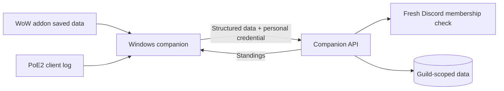

# Guilded companion: the Windows app

The companion is one branded interface for the Windows app. It is **Windows only**:
there is no Mac, Linux or browser version (the online companion was removed in
November 2026; its old `/companion/` addresses now lead to the download page).

It is optional if you only use the addon, which works in game on its own. It is
needed to share data with Discord and the website (achievements, leaderboards,
standings synced with your guild).

## Install

1. **Microsoft Store (recommended):** <https://apps.microsoft.com/detail/9N680XX3QFL9>.
   Store-signed, updates itself.
2. **Direct download (fallback):** the Windows installer on the latest
   [GitHub release](https://github.com/kevincaron28/Guilded/releases/latest). It is
   unsigned, so Windows may warn before running it.

## What it does

Overview shows actual sync state, never sample statistics. WoW has saved-data
and standings actions. PoE2 has the declared profile, upload queue and the
member's 15 most recent server observations. Activity supports search and
severity filters. Light/dark appearance is saved locally. Support summaries
exclude credentials, account IDs, paths and raw logs. Desktop tracking can be
paused and resumed without deleting settings.

| Capability | Windows companion |
| --- | --- |
| WoW character/profession/readiness sync | Watches Guilded.lua after /reload |
| WoW standings | Writes Standings.lua automatically |
| PoE2 observations | Watches new Client.txt entries |
| Existing PoE2 history | Skipped when first enabled |
| Background capture | Works in the tray |
| Unsent PoE2 visits | Durable device journal |
| Personal map history | Authenticated server view |

WoW still needs the Guilded addon to produce saved data. Visits are
observations, including portal reentry and possible failed loads; they prove no
clears, deaths, loot, XP or party participation and award no automatic points.

## Sign-in and privacy

Choose **Sign in with Discord** in Connection & setup: your browser opens the
website, you pick your server (or public leaderboards only) and press Connect. The
app listens on 127.0.0.1 and receives a one-time proof, so there is nothing to type.
Older companions can still use the one-time `/character pair` code.

Uploads use the personal credential header; no third-party scripts, broad CORS
policy or global token bypass is added. The bot freshly verifies Discord membership
and officer status, restricts personal WoW uploads to owned characters and always
binds PoE2 records to the authenticated member, including officers. Private API
responses are not cached.

## Build

`npm run companion:build` copies the shared design tokens and fonts and bundles the
interface helpers (`companion-app/renderer/ui-entry.js` into `ui-bundle.js`, which is
gitignored). `npm run dist --prefix companion-app` builds the per-user Windows
installer; the Microsoft Store package uses `npm run msix:store --prefix companion-app`.
All shared Node parser modules are included in packaged resources.

Never start a live bot to try the interface. Follow `V5_0_RELEASE_HANDOFF.md` and the
current release evidence for deployment gates.

## Link everything (companion screen)

`companion/link-everything.mjs` builds the status list; `companion-app/renderer/link-everything.js` shows it and is the first page a signed-out user sees (Skip for now remembers on this PC). It adds no sign-in scheme.

| Step | What it reuses | Where the status comes from |
| --- | --- | --- |
| Discord | Sign in with Discord (`/api/v1/companion/sign-in`, personal credential) | credential on this PC |
| Battle.net (optional) | the website's `/me/battlenet` flow (PR #312), opened by the existing `open-battlenet` IPC | `link.battleNet` in the hub answer (bot 8.4.0 + this PR) |
| Characters | the upload's existing paired-character linking and `linkVerifiedCharacters` (`/guilded verify`) | `characters` in the hub answer |

The only new IPC is `link-find-saved-data` (after sign-in; picks `Guilded.lua` when exactly one account has it, then asks for an upload). Against a bot without `link`, Battle.net shows "optional" and nothing breaks. Unlink: Manage connected devices (`/me/connections`), the Battle.net page's undo, Remove data & quit.
Not verifiable without a real Windows install and real Discord/Battle.net accounts: the live sign-in round trip, the file detection on a real WTF folder, and Battle.net discovery.

The page doubles as the main screen: link status, a character table (character, realm/edition, WoW guild and rank from PR #330, Discord server name, linked), and four big buttons (Sync now, Unlink this PC, Open Discord server, Settings). The hub answer gained `rank`, `guild.discordId` and `guild.serverName` per character and `link.battleTag`; all are the signed-in member's own data. Already-linked steps say so ("Already linked, nothing to do.") and never repeat.
