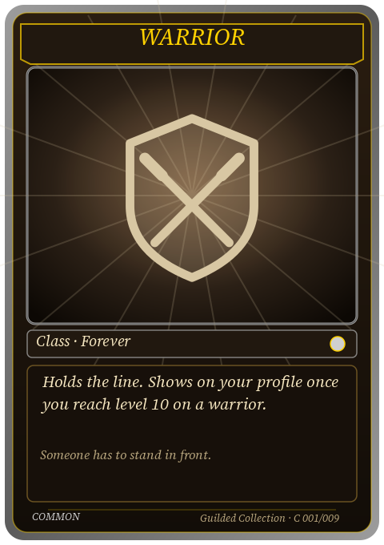
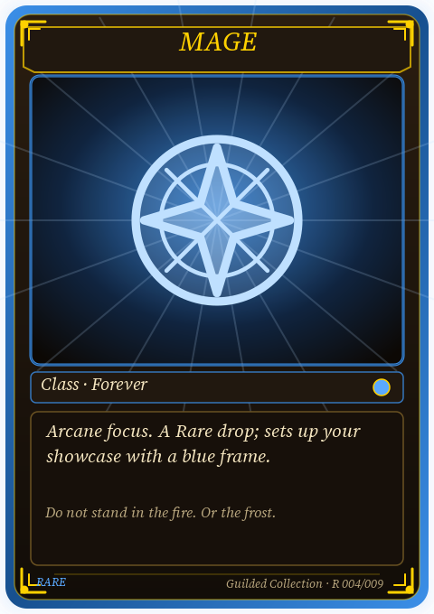
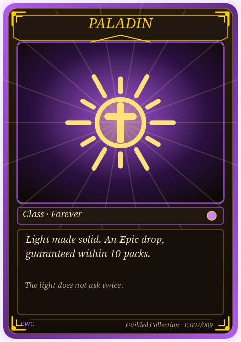
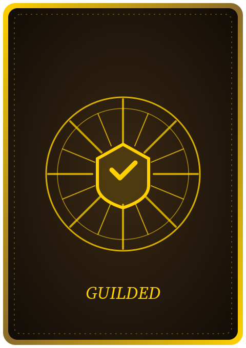
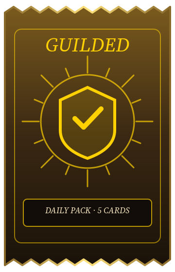

# Guilded Collection: card art proposal (option 2 of `APP_TCG.md`)

Status: **proposal for the owner to approve, 8 November 2026.** Nothing is built. Pick a direction (or ask for changes) before the pack build starts.

All art here is original Guilded vector iconography in the guild's WoW gold theme (the same dark stone, parchment and bright-gold palette as `src/services/score-card.ts`). No Blizzard art, icons or screenshots. Class names are plain text. Regenerate the samples with `node docs/plans/app-tcg-art/make-samples.mjs`.

## The three sample cards

| Common: Warrior | Rare: Mage | Epic: Paladin |
| --- | --- | --- |
|  |  |  |

Layout (identical on every card, so a grid of 120 cards reads at a glance): name banner on top, a square-ish art window, a type line with the rarity gem, a text box (what the card does or how it was earned, then one line of flavour), and the rarity and set number in the footer.

## Rarity frames

Rarity uses the colours WoW players already read as quality, so it feels native without copying any asset:

| Rarity | Frame | Extras |
| --- | --- | --- |
| Common | grey metal | plain edge, no glow, no corner trim |
| Uncommon | green metal | thin gold inner line |
| Rare | blue | soft outer glow, gold corner brackets |
| Epic | purple | stronger glow, gold corner brackets plus a crest over the art window |
| Legendary | orange with a gold foil edge | glow, brackets, crest, and a slow shimmer on the phone (a static foil in share images) |

Rules: colour is never the only signal (the footer also says the rarity in words and the gem shape grows with rarity), so it stays readable for colour-blind members. Rarer cards add ornament, not clutter: the art window and text positions never move.

## Class cards: the art idea

Each of the 9 classes is a bold, original emblem (shield and crossed blades, arcane star, sunburst cross, and so on) drawn as clean vector lines over a radial glow in the class tone. Three treatments per class (the plan's "9 x 3"): **plain emblem** (Common), **tinted glow** (Rare), **gilded emblem with sunburst rays** (Epic). It is cheap to draw, scales to any phone and reuses the same SVG approach as the badge glyphs in `achievement-badges.ts`. A later pass can swap in commissioned illustration without changing the frame.

## Card back and pack

| Card back | Pack |
| --- | --- |
|  |  |

- **Card back**: gold-bordered dark stone, a sunburst ring and the Guilded shield with a check. One back for everyone; the set-completion cosmetics in the plan can unlock alternate backs later.
- **Pack**: a crimped foil wrapper (zig-zag top and bottom) in bronze-to-dark gradient with the same shield, "Daily Pack, 5 cards". On open, the foil tears across the top, the cards fan out face down and flip one by one on tap with a "NEW" tag, as in the plan.

## What I need from the owner

1. **Direction**: keep this gold-and-stone look as is, or ask for a variant (lighter parchment frames, a more ornate Legendary, a different card back).
2. **Class emblems**: happy with abstract original emblems, or prefer commissioned illustration later (does not block the build).
3. **Names and flavour lines** are placeholders; they are English now and will get French translations in the build.

## Next (after approval)

Follow `APP_TCG.md` option 2: the data tables, the server-authoritative pack, daily and dust endpoints, then the app screens in `mobile/` (after the `mobile/` restructure lands). The frame and emblem code from `make-samples.mjs` becomes the card component's SVG.
