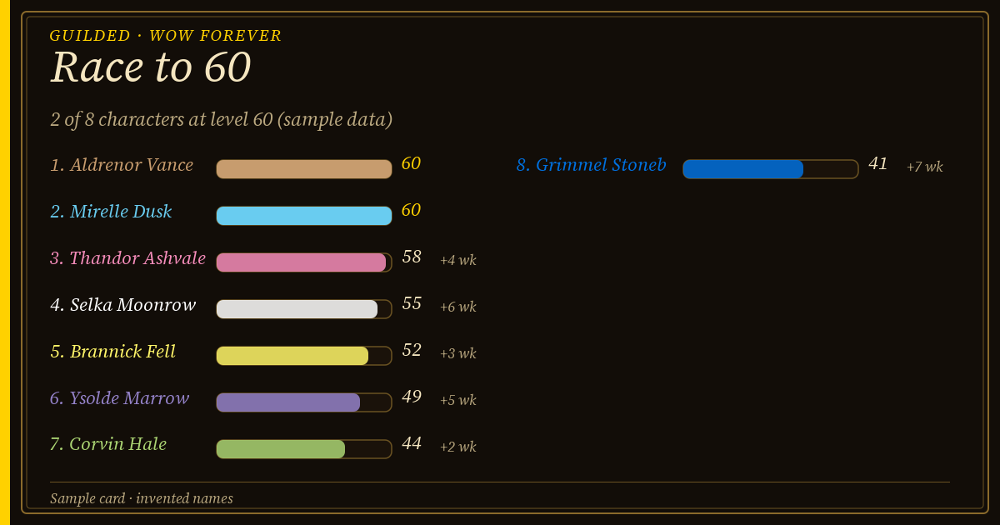
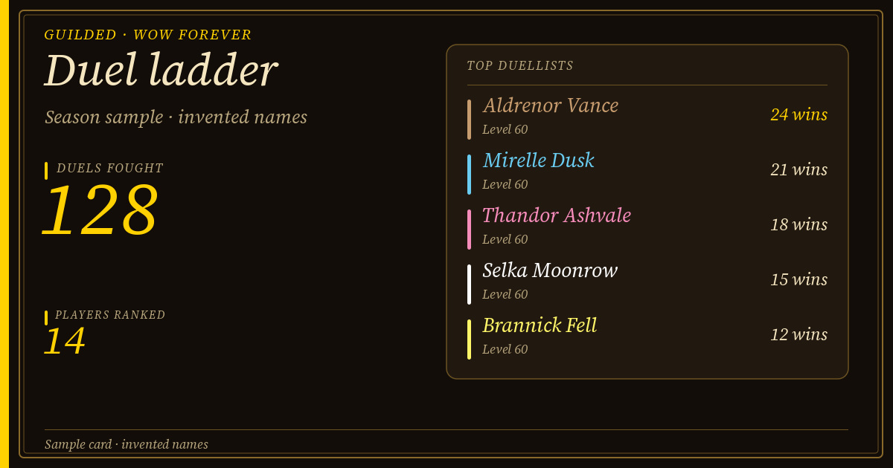
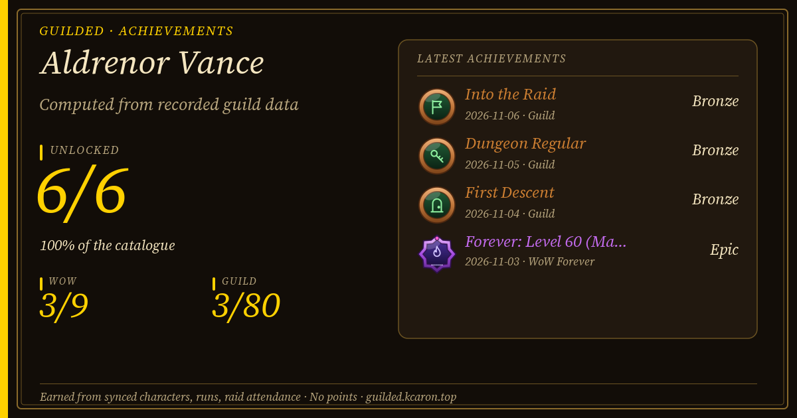

<section class="community-hero" aria-labelledby="community-title-fr">

QUEBEC GOLD · LA COMMUNAUTÉ

<h1 id="community-title-fr">De bonnes soirées. De belles <em>aventures.</em></h1>

Des gens avec qui jouer, en français et à l'heure de Montréal. Retrouvez Quebec Gold sur <strong>WoW Forever</strong><!--poe: et <strong>Path of Exile 2</strong>-->.

<a class="button" href="https://discord.gg/PCs8BeE8bg">Rejoindre notre Discord ↗</a><a class="button secondary" href="../g/quebec-gold/">Découvrir nos cores →</a>

Communauté francophoneMontréal · America/TorontoWoW Forever · Horde · PvP

</section>

<strong>FR</strong>Le français d'abord, tout le monde est bienvenu

<strong>2</strong>Cores de raid, chacun avec son horaire et ses règles de butin

<strong>Horde</strong>WoW Forever, royaume PvP

<strong>9.0</strong>Tableaux, classements et saisons Guilded intégrés

<article>01 / WORLD OF WARCRAFT · RECRUTEMENT<h2>Votre prochaine <em>guilde.</em></h2>
WoW Forever, côté Horde, royaume PvP. Deux cores de raid, leurs horaires et leurs règles de butin, à jour en direct : trouvez le groupe qui vous correspond.
<a class="button" href="../g/quebec-gold/">Rencontrer la guilde →</a></article>
<article>02 / PATH OF EXILE 2<h2>La prochaine ligue. <em>Ensemble.</em></h2>
Progression, cartes et entraide. Retrouvez les joueurs de la communauté et discutez de votre ligue, de votre mode et de vos disponibilités.
<a class="button secondary" href="poe2/">Trouver votre groupe →</a></article> <!--poe-->

## Qui nous sommes

Quebec Gold est une guilde francophone de WoW Forever, côté Horde sur un royaume PvP. Nous jouons en français, à l'heure de Montréal (avec ses changements d'heure saisonniers), et nous avons **deux cores de raid**, une saison de donjons et une vie PvP active. Les soirs de raid, les règles de banc et de butin varient selon le core et changent avec le temps : la [page de guilde](../g/quebec-gold/) en direct fait foi, pas cette page. Confirmez votre place avec l'équipe sur Discord avant de vous engager.

<!-- screenshot: Quebec Gold guild roster window in game (/guilded), showing class icons, levels and online members; guild name visible, character names may be real if the members agree. Landscape, at least 1280 wide. -->

## Comment nous rejoindre

<ol class="join-steps">
<li>1
<h3>Rejoignez le Discord</h3>
Utilisez le <a href="https://discord.gg/PCs8BeE8bg">lien d'invitation</a>, dites bonjour et indiquez le jeu qui vous amène. Pour WoW, ajoutez votre classe, votre rôle et vos disponibilités.

</li>
<li>2
<h3>Publiez votre personnage dans #invitation-guilde</h3>
Écrivez le nom complet de votre personnage, prénom et nom ensemble (par exemple <em>Prénom Nom</em>). Le bot réagit avec 👀 pour confirmer que c'est lu.

</li>
<li>3
<h3>Un officier vous invite</h3>
Les officiers voient une file des noms en attente, dans Discord et en jeu, et envoient l'invitation de guilde à la main. Vous recevez un ✅ quand c'est fait.

</li>
<li>4
<h3>Liez vos personnages</h3>
Installez une fois le compagnon Windows gratuit : il lie vos personnages à votre compte Discord, et vos tableaux, succès et classements vous suivent.

</li>
</ol>

<!-- screenshot: the #invitation-guilde channel in Discord with one request showing the 👀 reaction and a finished one showing ✅ (hide Discord usernames). Landscape. -->

## Ce que Guilded apporte aux membres

<article>🏁<h3>Course au 60</h3>
Un tableau en direct de tous ceux qui montent en niveau, avec un temple de la renommée pour les premiers au maximum.
</article>
<article>🏆<h3>Succès</h3>
Des jalons, du niveau 20 aux premiers donjons terminés, présentés en cartes à partager.
</article>
<article>🗝️<h3>Saison de donjons</h3>
Vos runs sont enregistrés pendant que vous jouez et classés par saison, avec des règles communes et figées.
</article>
<article>⚔️<h3>Classements de duels et de champs de bataille</h3>
Des classements pour les deux, avec un tableau de duels en direct.
</article>
<article>📣<h3>Appel à l'aide</h3>
Demandez un groupe PvP ou un partenaire de niveau sans inonder le chat.
</article>
<article>📅<h3>Inscription aux raids en jeu</h3>
Inscrivez-vous depuis la fenêtre du jeu; les mêmes inscriptions apparaissent dans Discord.
</article>

## Exemples de cartes

Guilded dessine ces cartes pour Discord et le web. Les noms et les chiffres ci-dessous sont inventés pour l'illustration.

<figure><figcaption>Tableau de la course au 60</figcaption></figure>
<figure><figcaption>Classement des duels</figcaption></figure>
<figure><figcaption>Succès</figcaption></figure>

<!-- screenshot: Guilded's in-game "Guilded" tab of the dungeon finder showing a recent run list and the current season ranking. Landscape. -->

<aside class="member-band">
<h2>Déjà dans la guilde ?</h2>
Retrouvez vos cores, les classements EPGP, les prix et votre wishlist avec le compagnon Windows (Microsoft Store). Votre code personnel se saisit uniquement dans le compagnon.

<a class="button secondary" href="/companion/">Obtenir le compagnon ↗</a></aside>

## Et Guilded ?

Guilded est l'outil de gestion de guilde, avec un addon WoW, un compagnon et une intégration Discord facultative. Vous pouvez utiliser l'addon sans rejoindre Quebec Gold et sans Discord.

[Découvrir les fonctionnalités de Guilded](../features/) · [Téléchargements](../index.html#start)
