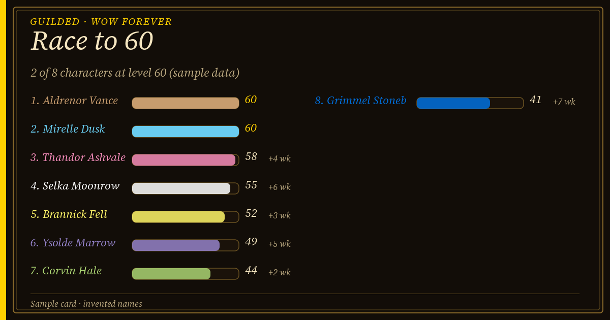
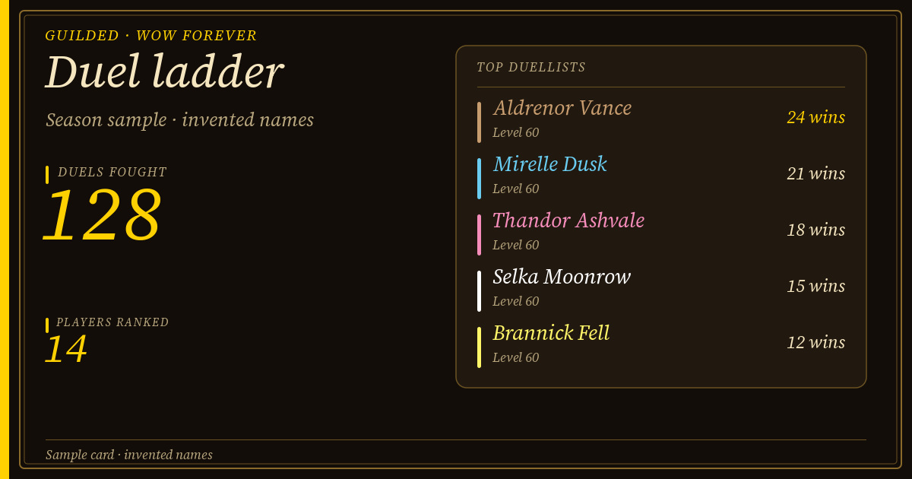
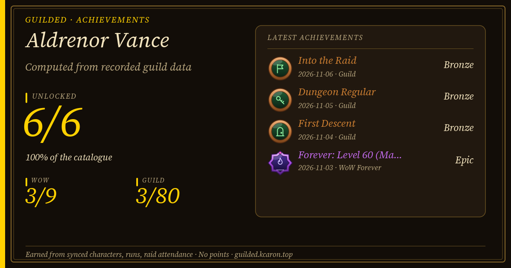

<section class="community-hero" aria-labelledby="community-title">

QUEBEC GOLD · THE COMMUNITY

<h1 id="community-title">Good evenings. Good <em>adventures.</em></h1>

People to play with, in French and on Montréal time. Find Quebec Gold on <strong>WoW Forever</strong><!--poe: and <strong>Path of Exile 2</strong>-->.

<a class="button" href="https://discord.gg/PCs8BeE8bg">Join our Discord ↗</a><a class="button secondary" href="../g/quebec-gold/">Meet our cores →</a>

French-speaking communityMontréal · America/TorontoWoW Forever · Horde · PvP

</section>

<strong>FR</strong>French first, everyone welcome

<strong>2</strong>Raid cores, each with its own schedule and loot rules

<strong>Horde</strong>WoW Forever, PvP realm

<strong>9.0</strong>Guilded boards, ladders and seasons built in

<article>01 / WORLD OF WARCRAFT · RECRUITING<h2>Your next <em>guild.</em></h2>
WoW Forever, Horde side, PvP realm. Two raid cores, with their schedules and loot rules kept up to date live: find the group that fits you.
<a class="button" href="../g/quebec-gold/">Meet the guild →</a></article>
<article>02 / PATH OF EXILE 2<h2>The next league. <em>Together.</em></h2>
Progress, maps and mutual help. Meet the community players and talk about your league, your mode and your availability.
<a class="button secondary" href="poe2/">Find your group →</a></article> <!--poe-->

## Who we are

Quebec Gold is a francophone WoW Forever guild on the Horde side of a PvP realm. We play in French, on Montréal time (with its seasonal clock changes), and we run **two raid cores**, a dungeon season, and a lively PvP scene. Raid nights, bench rules and loot rules differ by core and change over time, so the live [guild page](../g/quebec-gold/) is the source of truth, not this page. Confirm your place with the team on Discord before committing.

<!-- screenshot: Quebec Gold guild roster window in game (/guilded), showing class icons, levels and online members; guild name visible, character names may be real if the members agree. Landscape, at least 1280 wide. -->

## How to join

<ol class="join-steps">
<li>1
<h3>Join the Discord</h3>
Use the <a href="https://discord.gg/PCs8BeE8bg">invite link</a>, say hello and tell us which game you came for. For WoW, add your class, role and availability.

</li>
<li>2
<h3>Post your character in #invitation-guilde</h3>
Write your full character name, first and last name together (for example <em>Firstname Lastname</em>). The bot reacts with 👀 so you know it was read.

</li>
<li>3
<h3>An officer invites you</h3>
Officers see a queue of waiting names, in Discord and in game, and send the guild invite by hand. You get a ✅ when it is done.

</li>
<li>4
<h3>Link your characters</h3>
Install the free Windows companion once: it links your characters to your Discord account, so your boards, achievements and standings follow you.

</li>
</ol>

<!-- screenshot: the #invitation-guilde channel in Discord with one request showing the 👀 reaction and a finished one showing ✅ (hide Discord usernames). Landscape. -->

## What members get with Guilded

<article>🏁<h3>Race to 60</h3>
A live board of everyone levelling, with a Hall of Fame for the first to reach the cap.
</article>
<article>🏆<h3>Achievements</h3>
Milestones from levels to first dungeon clears, shown as shareable cards.
</article>
<article>🗝️<h3>Dungeon season</h3>
Your runs are recorded as you play and ranked by season, with rules shared and frozen for everyone.
</article>
<article>⚔️<h3>Duel and battleground ladders</h3>
Ranked ladders for both, plus a live duel board.
</article>
<article>📣<h3>Call for help</h3>
Ask for a PvP group or a levelling partner without spamming chat.
</article>
<article>📅<h3>Raid sign-up in game</h3>
Sign up from the game window; the same signups appear in Discord.
</article>

## Sample cards

Guilded draws these cards for Discord and the web. The names and numbers below are made up for illustration.

<figure><figcaption>Race to 60 board</figcaption></figure>
<figure><figcaption>Duel ladder</figcaption></figure>
<figure><figcaption>Achievements</figcaption></figure>

<!-- screenshot: Guilded's in-game "Guilded" tab of the dungeon finder showing a recent run list and the current season ranking. Landscape. -->

<aside class="member-band">
<h2>Already in the guild?</h2>
Find your cores, EPGP standings, prices and wishlist with the Windows companion (Microsoft Store). Your personal code is entered only in the companion.

<a class="button secondary" href="/companion/">Get the companion ↗</a></aside>

## And Guilded?

Guilded is the guild management tool, with a WoW addon, a companion and an optional Discord integration. You can use the addon without joining Quebec Gold and without Discord.

[Explore Guilded's features](../features/) · [Downloads](../index.html#start)
